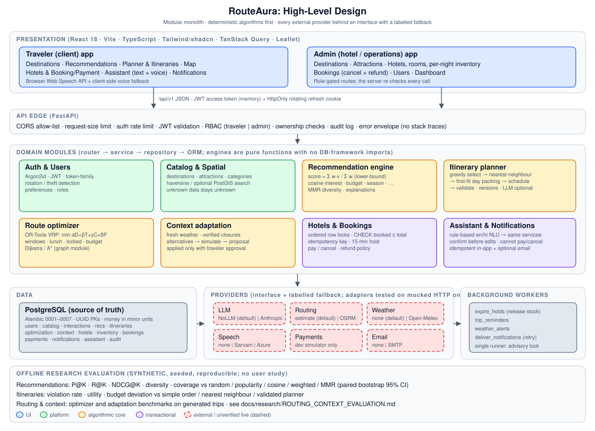
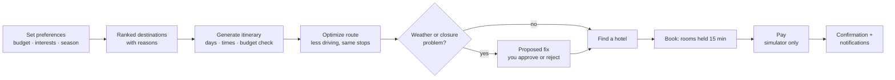
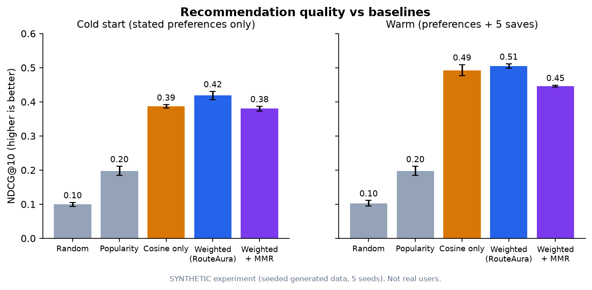
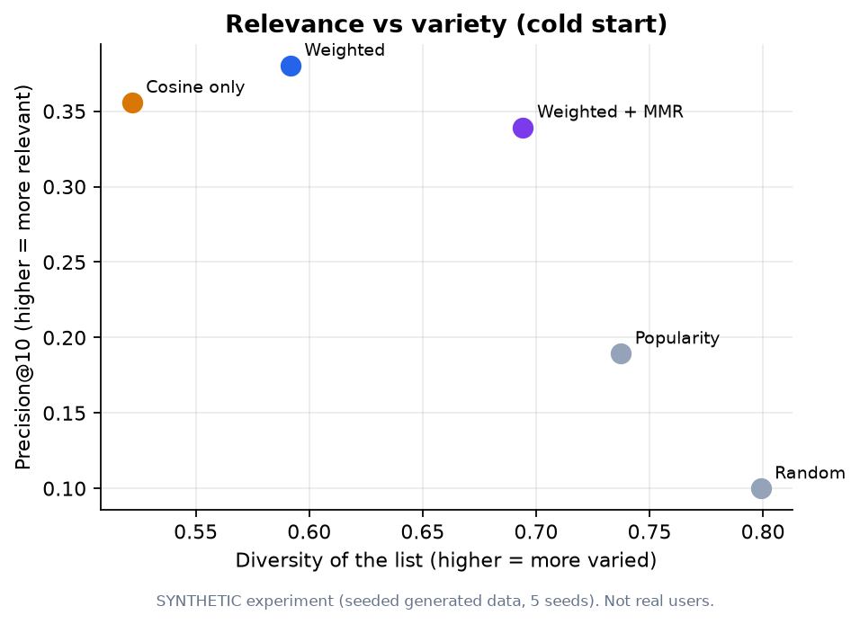
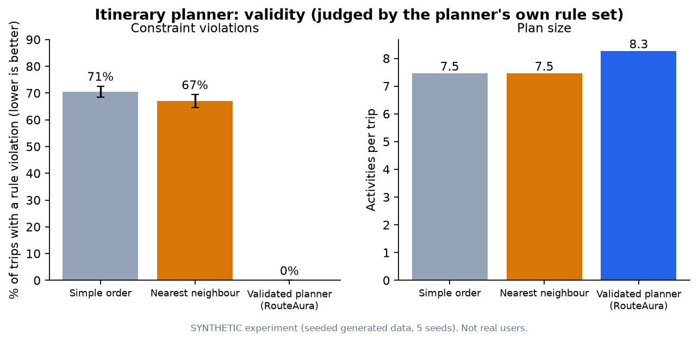
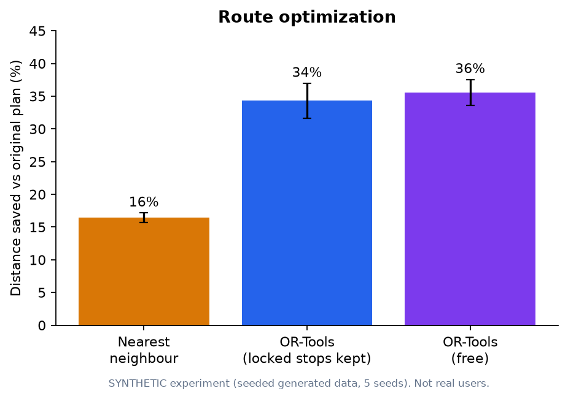
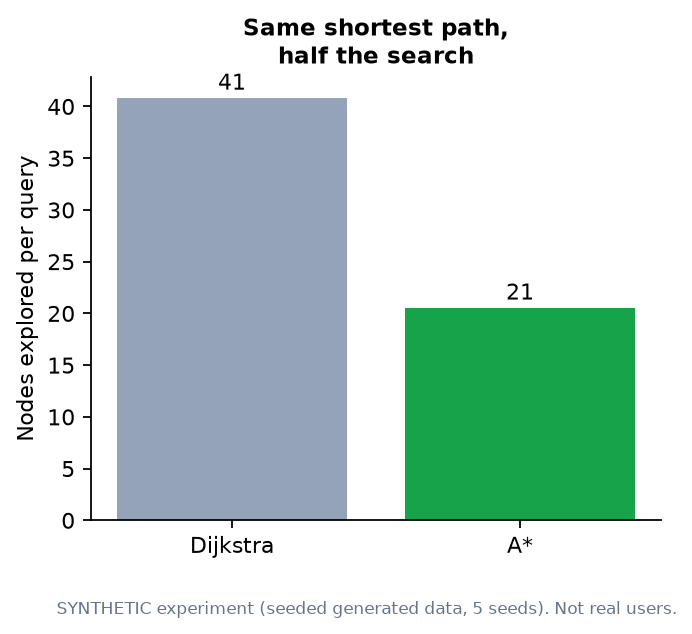
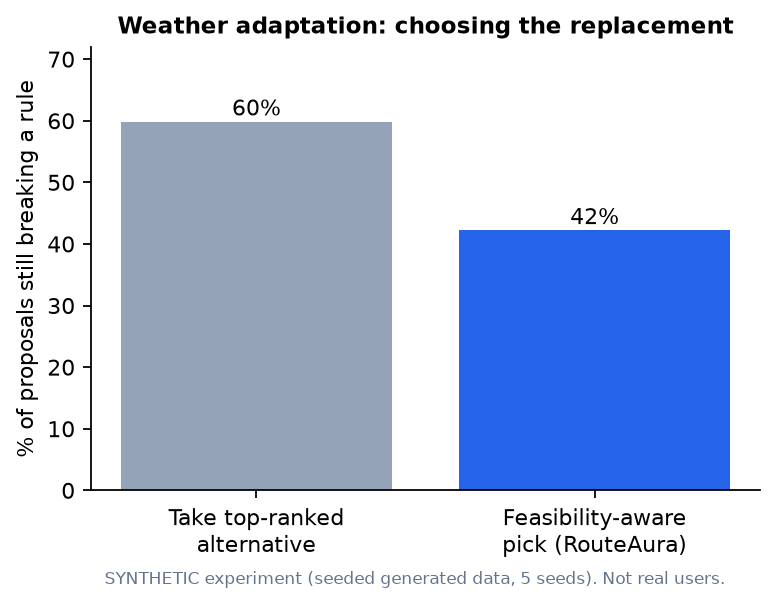
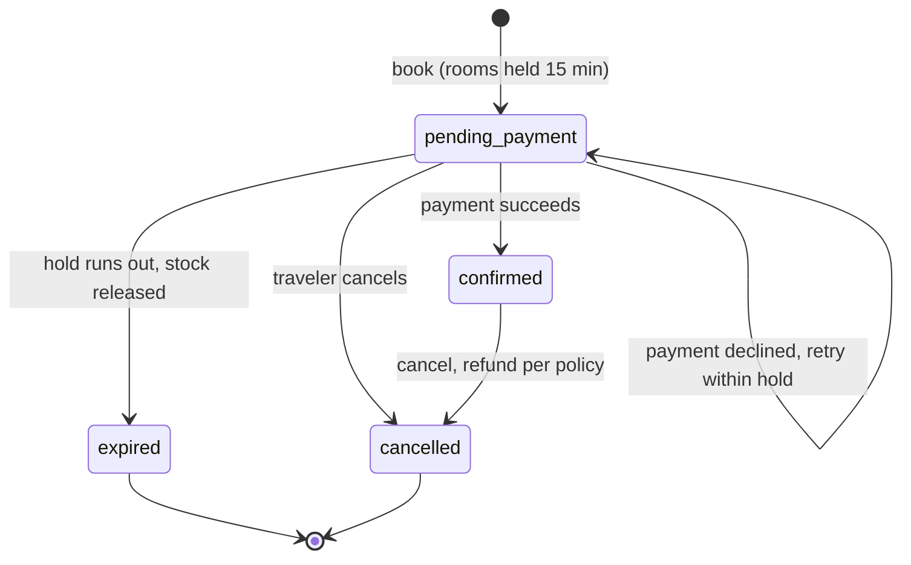

# RouteAura

**An AI-assisted trip planner.** Tell it your budget, interests and dates. It ranks destinations, builds a day-by-day itinerary, shortens the driving between stops, proposes changes when the weather turns, and lets you book a hotel, by typing or by voice (English and Hindi).

RouteAura is an academic research project (IILM University). Its main idea is **explainable, rule-checked planning**: classic algorithms do the planning and checking, and an LLM is only an optional helper. Every score shows why it was given, and every number that is a guess is labelled as a guess.



> **Read this first: what is and isn't real**
> - **Built and tested:** the API, database, algorithms, web app, booking logic and background jobs (see the test counts in [docs/IMPLEMENTATION_STATUS.md](docs/IMPLEMENTATION_STATUS.md)).
> - **Not connected to live services:** payments are a **development simulator**. Weather, road routing, speech, email and the LLM have adapters that were tested only against mocked responses, never the live services. When a provider isn't configured, the app falls back to a clearly labelled estimate or says "unknown".
> - **Demo data is fictional:** 5 destinations, 20 attractions and a few hotels with placeholder prices. There is no real user data.
> - **Research numbers are synthetic:** the charts below come from seeded, generated data. They are **not** a user study.

---

## What a traveler can do



| Traveler | Admin |
|---|---|
| Personalised recommendations with a per-factor explanation | Manage destinations and attractions |
| AI-assisted or fully rule-based itinerary generation | Manage hotels, room types and per-night inventory |
| Route optimization and weather/closure adaptation (with approval) | View, cancel and refund bookings |
| Hotel search, booking, simulated payment, cancellation with refund preview | Manage users, view platform dashboard |
| Text and voice assistant in English and Hindi | |
| In-app notifications (email optional) | |

---

## How it works

### 1. Recommendations: a transparent weighted score

Each destination gets a score from 0 to 1 built from six factors the traveler has set:

`score = Σ weight × fit  ÷  Σ weight` (over the factors you actually specified)

| Factor | Weight | How "fit" is measured |
|---|---|---|
| Interests | 0.35 | cosine similarity between your interests and the place's categories |
| Budget | 0.20 | 1 if within budget, falling to 0 at 50% over |
| Season | 0.15 | share of your travel months in the place's best season |
| Trip length | 0.10 | 1 within ±1 day of the recommended stay |
| Climate | 0.10 | exact match, or a hand-set similarity |
| Travel style | 0.10 | derived from cost and category mix |

If the catalogue doesn't know something (for example a cost), that factor scores **0 and lowers the reported confidence**. Missing data never raises a score. An optional **MMR** step re-orders results to avoid a list of near-duplicates. The weights are design choices, not learned values.



*Higher is better. In the warm-start panel the gap between "Cosine only" and the weighted score is within the margin of error, so don't read it as a win. The weighted score is clearly ahead of popularity and random.*



*MMR trades a little relevance for a more varied list. You choose that trade-off.*

### 2. Itineraries: a planner that checks its own work

1. Pick the best-scoring places that fit the available time and the money left after living costs.
2. Order them by nearest neighbour, then pack them into days (first-fit).
3. Schedule start times, a lunch break and opening hours, using travel-time estimates.
4. Validate: day overruns, closed venues, daily limit and budget. Costs that are unknown are counted separately, not guessed.



*The planner reaches zero violations because it is judged by the same rule set it plans with. That shows self-consistency, not real-world feasibility.*

### 3. Route optimization

An OR-Tools vehicle-routing model assigns stops to days and orders them to minimise
`α·distance + β·time + γ·travel cost + δ·preference penalty`, respecting day hours, verified opening windows, lunch, locked "must-do" stops and the budget. If no plan satisfies everything it says so and returns a clearly labelled relaxed plan. Dijkstra and A* are implemented and tested separately for shortest-path queries.





*Travel times are great-circle estimates (× 1.3 detour at 30 km/h) unless an OSRM server is configured, so these show ordering quality, not real road times. The A* result is on synthetic graphs, not road networks.*

### 4. Weather and closure adaptation

Only **fresh** forecasts (under 3 hours old) and **admin-verified** opening hours trigger anything. The system proposes a replacement and simulates the whole plan first. **Nothing changes until the traveler approves.**



*Choosing the replacement by simulating the full plan beats blindly taking the top-ranked alternative, but a large share of proposals still break a rule. The preview shows those so the traveler decides with full information.*

### 5. Bookings that can't oversell



- Room stock is protected **by the database**: rows are locked in date order and a constraint enforces `booked ≤ total`. Concurrent-booking tests run on real PostgreSQL.
- Retrying the same request with the same `Idempotency-Key` never double-books.
- Refunds: 100% if cancelled 2 or more days ahead, 50% at 1 day, otherwise 0. An admin cancellation refunds in full.
- Payments use a **development simulator**. No real money moves.

### 6. The assistant

A rule-based English/Hindi understanding layer (no LLM required) turns requests such as "plan 3 days in Goa under 30,000" into calls to the same recommendation, itinerary and booking services the web app uses. It asks for a yes/no before any edit and **cannot pay or cancel**. Voice uses a speech provider if configured, otherwise the browser's built-in speech API.

---

## Tech stack

| Layer | Technology |
|---|---|
| Web app | React 18, TypeScript, Vite, Tailwind, shadcn/ui, TanStack Query, react-hook-form + zod, Leaflet |
| API | Python 3.12, FastAPI, SQLAlchemy 2, Alembic, Pydantic v2 |
| Data | PostgreSQL (PostGIS optional; a haversine fallback is used otherwise) |
| Algorithms | Pure-Python engines, Google OR-Tools, NetworkX (tests only) |
| Security | Argon2id, short-lived JWT + rotating refresh cookie, role checks, rate limiting |
| Tests | pytest (backend), Vitest + Testing Library (frontend) |

---

## Run it locally

Prerequisites: Node 20+, [uv](https://docs.astral.sh/uv/), PostgreSQL 14+.

```bash
# 1. Backend
cd backend
createdb routeaura && createdb routeaura_test
cp .env.example .env            # then set JWT_SECRET (see comment inside)
uv sync
uv run alembic upgrade head
uv run python -m app.scripts.seed_dev      # dev-only seed accounts
uv run python -m app.scripts.seed_catalog  # demo destinations, attractions, hotels (optional)
uv run uvicorn app.main:app --reload --port 8000   # API docs: http://localhost:8000/docs

# 2. Frontend (new terminal, repo root)
npm ci
npm run dev                     # proxies /api to :8000
```

Tests: `cd backend && uv run pytest -q` and `npm test`.
Docker: copy `.env.example` to `.env`, fill the secrets, then `docker compose up --build` (**not yet verified end to end**, see [docs/IMPLEMENTATION_STATUS.md](docs/IMPLEMENTATION_STATUS.md)).

Reproduce the research charts: from `backend/`, run `uv run python -m app.scripts.evaluate_recommendations --seeds 42 43 44 45 46 --out ../docs/research/results` (likewise `evaluate_itineraries` and `evaluate_routing`), then `uv run --with matplotlib python ../docs/images/make_charts.py`. Every bar is read from `docs/research/results/*.json`.

---

## Where to read more

| Topic | Document |
|---|---|
| What is verified and what is not | [docs/IMPLEMENTATION_STATUS.md](docs/IMPLEMENTATION_STATUS.md) |
| Architecture and database design | [docs/ARCHITECTURE.md](docs/ARCHITECTURE.md) |
| API reference | [docs/API.md](docs/API.md) |
| Migrations and PostGIS | [docs/MIGRATIONS.md](docs/MIGRATIONS.md) |
| Research method, results and limits | [docs/research/](docs/research/) |

---

## Project information

**Course:** Web Technologies · **Institution:** IILM University · **Submitted to:** Mr. Shobhit Agarwal

**Team:** Kushal, Shikha Singh, Kunwar Aryan Singh, Ruprekha (Team Aurocode)

This is an academic project built for learning and research. Suggestions are welcome through pull requests.
